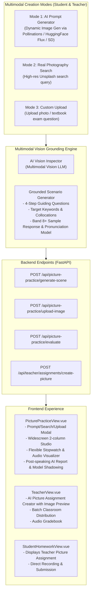

# Describe Picture Studio & Teacher Assignment Overhaul Design

## 1. Executive Summary & Goals
The **Describe Picture** feature (IELTS Speaking Part 2 & TOEIC Speaking Questions 3-4 format) is overhauled to be truly AI-driven, pedagogically sound, and aligned for both Students and Educators.

### Key Pain Points Solved
1. **No more static 20-image limit**: Supports dynamic AI image generation from any custom user prompt, authentic real-world photography search, and direct image upload (e.g. from textbook/exam prompts).
2. **Strict Multimodal Vision Grounding**: Once an image is generated or uploaded, an AI Vision Inspector analyzes the visual elements in the image to formulate 100% matched guiding questions (4-step framework: Overall Scene -> Central Subject & Actions -> Surroundings & Details -> Atmosphere/Impressions) and target keywords that physically exist in the picture.
3. **Flexible Student Speaking Studio**: Replaces high-stress forced countdowns with a flexible stopwatch accompanied by target duration guidelines (<30s too short, 45s-60s ideal, >75s extended). Keyword usage and content coverage are evaluated in depth during post-recording analysis.
4. **Relational Storage Optimization for Teacher Assignments**: When a teacher assigns a picture speaking task, the image is stored exactly once on the assignment record (`assignments.image_url`). Student submissions only store the individual student's audio recording and evaluation metrics, without duplicating image assets.

---

## 2. System Architecture

---

## 3. Data Model & Database Schema

### Assignments Table (`assignments`)
Stores teacher-created assignments. Only one image URL is stored per assignment.
- `id`: INTEGER PRIMARY KEY AUTOINCREMENT
- `classroom_id`: INTEGER NOT NULL
- `teacher_id`: INTEGER NOT NULL
- `title`: TEXT NOT NULL
- `type`: TEXT NOT NULL (value: `"picture"`)
- `topic_sentence`: TEXT (topic or prompt description)
- `image_url`: TEXT NOT NULL (single shared image for the entire class)
- `prompt_guide`: TEXT (JSON array string of 4 guiding questions)
- `keywords`: TEXT (JSON array string of target keywords)
- `sample_response`: TEXT (Band 8+ model response)
- `created_at`: TIMESTAMP DEFAULT CURRENT_TIMESTAMP

### Submissions Table (`student_assignment_submissions` / `history`)
Stores student homework submissions. No duplicated image data.
- `id`: INTEGER PRIMARY KEY AUTOINCREMENT
- `assignment_id`: INTEGER NOT NULL REFERENCES assignments(id)
- `user_id`: INTEGER NOT NULL REFERENCES users(id)
- `audio_url`: TEXT NOT NULL (student's audio recording file)
- `transcription`: TEXT (Whisper ASR transcription)
- `overall_score`: REAL (AI score 0 - 10)
- `ai_feedback`: TEXT (Detailed multi-criteria feedback)
- `status`: TEXT DEFAULT 'submitted'
- `created_at`: TIMESTAMP DEFAULT CURRENT_TIMESTAMP

### Practice Scenarios Table (`picture_scenarios`)
Stores student standalone practice history.
- `id`: INTEGER PRIMARY KEY AUTOINCREMENT
- `user_id`: INTEGER NOT NULL
- `topic`: TEXT
- `title`: TEXT
- `image_url`: TEXT NOT NULL
- `image_prompt`: TEXT
- `prompt_guide`: TEXT (JSON guiding questions)
- `keywords_json`: TEXT (JSON target keywords)
- `guiding_questions_json`: TEXT
- `created_at`: TIMESTAMP DEFAULT CURRENT_TIMESTAMP

---

## 4. Multimodal Generation & Vision Grounding Pipeline

### Dynamic Image Generation
1. **AI Image Generation**: When prompt is provided, generates image via dynamic prompt with fast fallback to high-resolution search.
   - Provider: Fast Pollinations / Hugging Face Spaces / Unsplash dynamic search URL:
   - `https://image.pollinations.ai/prompt/{encoded_prompt}?width=1024&height=680&nologo=true`
   - Fallback: Unsplash high-resolution photography keyword search URL:
   - `https://images.unsplash.com/photo-...` via keyword matching.
2. **Image Upload**: Uploads to `uploads/picture_practice/` static directory and returns static URL `/uploads/picture_practice/{filename}`.
3. **Vision Grounding**:
   - Calls Vision LLM (or descriptive prompt grounding) to inspect the image elements.
   - Outputs:
     - `title`: Engaging, concise title.
     - `guiding_questions`: 4 questions adhering to standard English speaking test structure:
       1. Overview (Location, time, general setting).
       2. Central Subject & Actions (Who is there and what are they doing?).
       3. Details & Surroundings (Foreground, background, objects).
       4. Impressions & Feelings (Atmosphere, emotional tone).
     - `keywords`: 5-6 target collocations and descriptive terms.
     - `sample_response`: Natural 60-second Band 8+ model speech for listening and shadowing.

---

## 5. User Experience & Sizing

### Student Practice Studio (`PicturePracticeView.vue`)
- **Creation Dialog**: 3 Tabs (AI Prompt Generator, Search Real Photos, Upload Image).
- **Practice Studio**:
  - Left Column: Image display (with full-screen zoom), 4-step framework accordion/chips, target keywords checklist.
  - Right Column:
    - Audio recorder with live microphone level visualizer.
    - Stopwatch timer: displays elapsed time `MM:SS` with color-coded target indicators (`<30s` amber, `45s-60s` green, `>75s` blue). Optional Exam Mode toggle (45s TOEIC countdown).
    - Post-speech assessment: overall score, content coverage analysis, keywords detected in speech, model answer player for shadowing.

### Teacher Assignment Creation (`TeacherView.vue`)
- Add **"AI Picture Assignment"** modal in Teacher Hub.
- Teacher can type a prompt or upload an image -> preview generated scene -> edit questions/keywords -> assign to one or more classrooms.

### Student Homework Flow (`StudentHomeworkView.vue`)
- Displays the assignment with image and guiding questions.
- Student records audio, gets evaluated, and submits to teacher without duplicating image storage.
